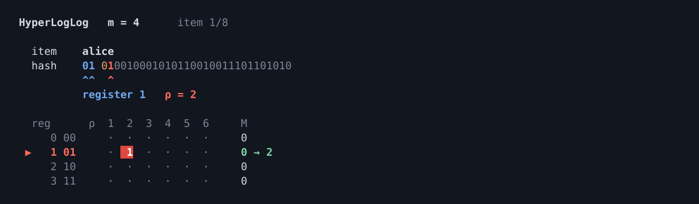
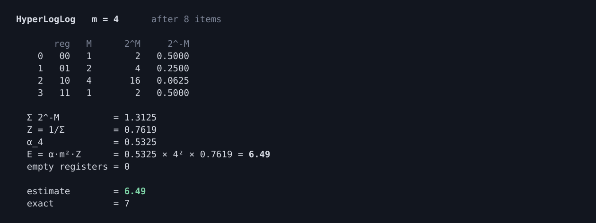
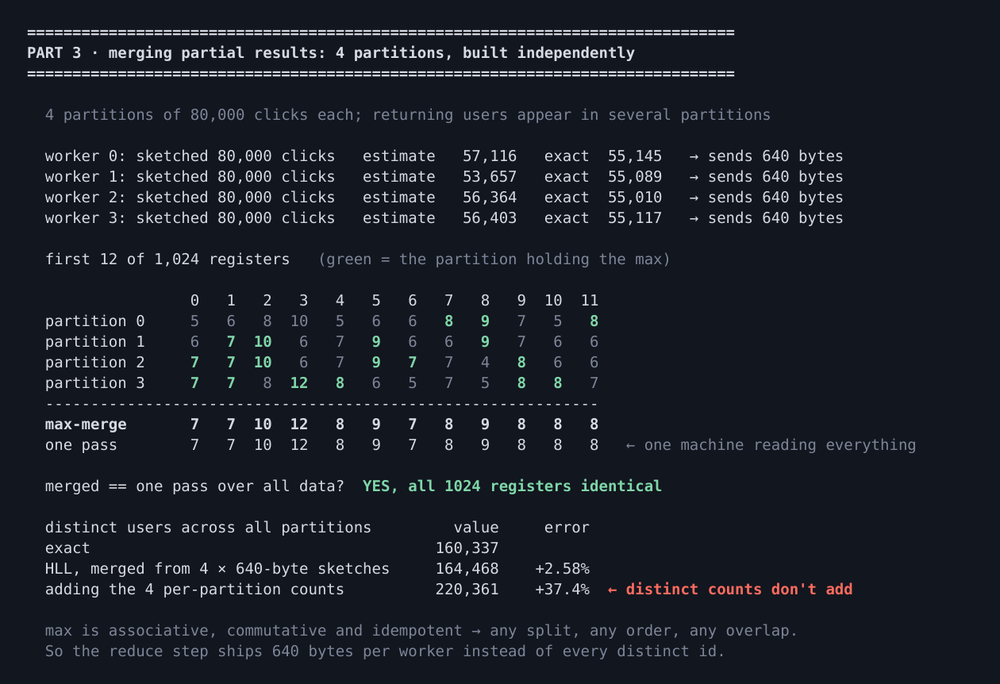
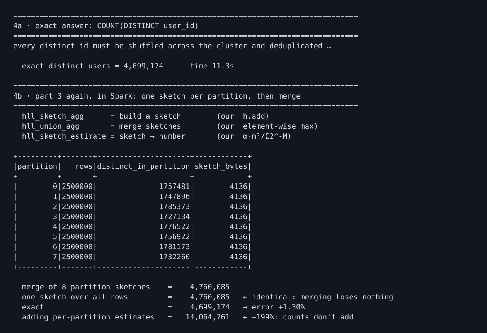
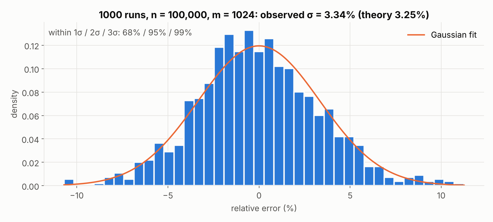
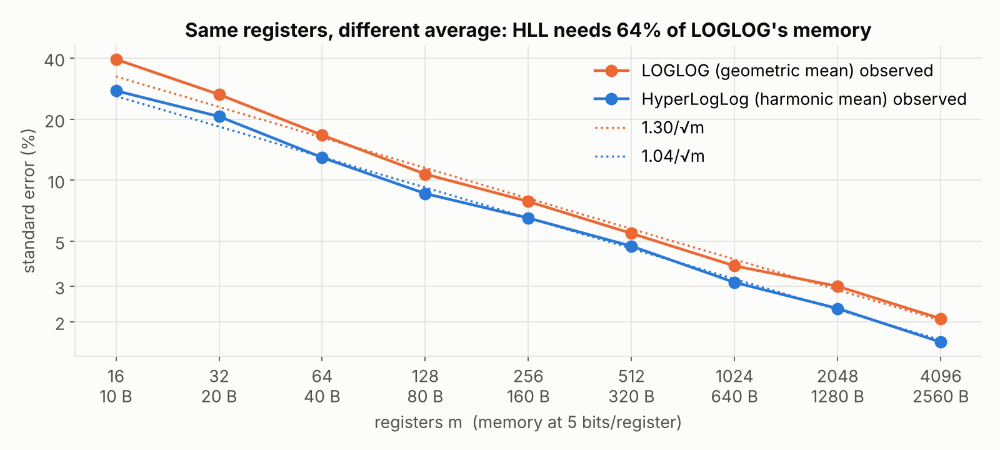
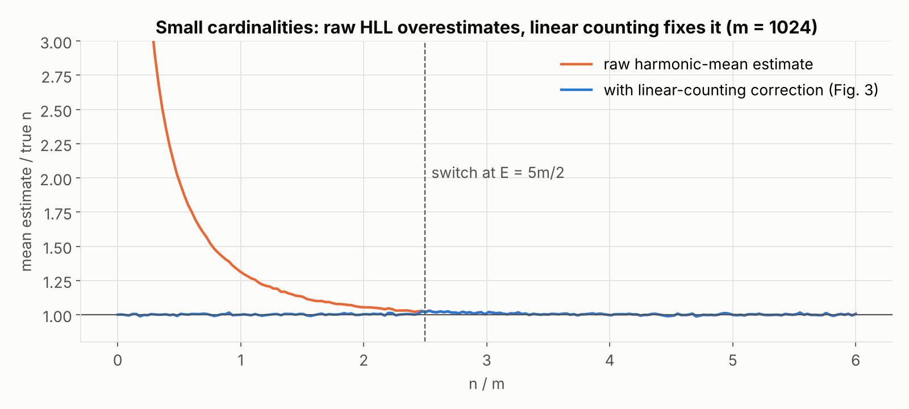

# HyperLogLog

**Count the distinct items in huge data using a few kilobytes of memory, and watch every bit of how it works.**

This project builds a HyperLogLog by hand, small enough to follow each hash bit, and then runs the same algorithm in Apache Spark on 20 million rows to compare it with the exact answer.

Based on *HyperLogLog: the analysis of a near-optimal cardinality estimation algorithm* (Flajolet, Fusy, Gandouet & Meunier, 2007).

| 20 million clicks, 8 partitions | Exact `COUNT(DISTINCT)` | HyperLogLog in Spark |
|---|---|---|
| Distinct users | 4,699,174 | 4,760,085 (**+1.3%**) |
| Memory per partition | every user ID | **4,136 bytes** (4,096 registers) |

---

## Contents

- [Why HyperLogLog?](#why-hyperloglog)
- [How it works](#how-it-works)
- [Quick start](#quick-start)
- [The four demos](#the-four-demos)
- [Accuracy](#accuracy)
- [Command options](#command-options)
- [Project structure](#project-structure)
- [Implementation notes](#implementation-notes)
- [Limitations](#limitations)
- [References](#references)

---

## Why HyperLogLog?

Many questions are about **how many different** things there are: unique visitors to a website, distinct search queries, distinct network connections.

The exact way remembers every item it has seen:

- **Memory grows** with every new distinct item.
- **On a cluster**, the same item can appear on many machines, so all items must be sent to one place to remove duplicates.
- **Counts don't add.** Monday's users plus Tuesday's users is not this week's users.

HyperLogLog keeps a **small, fixed set of numbers (registers)** instead of the items. It reads each item once, its memory never grows, and sketches from different machines **merge exactly**. The trade-off is that the answer is an estimate, typically within 1–2%.

## How it works

**1. Hash each item into random-looking bits.** The same item always gives the same bits.

**2. The first `b` bits pick a register, and the rest gives ρ.** ρ ("rho") is the position of the first 1. Half of all hashes start with `1` (ρ = 1), a quarter with `01` (ρ = 2), and so on, so a large ρ is rare.

```
h("alice") = 01 | 010010001010110010011101101010
             ││    │
             ││    └─ first 1 at position 2  →  ρ = 2
             └┴─ register 01 = register 1
```

**3. Each register keeps only its biggest ρ**, called `M[j]`. A duplicate has the same hash, register and ρ, so it can never change anything.

**4. Turn the registers into an estimate.** Each register guesses about `2^M[j]` items. The guesses are combined with a **harmonic mean**, which keeps one unusually high guess from taking over. The result is multiplied by the number of registers `m` and a bias correction `α`:

```
E = α · m · (harmonic mean of 2^M[j])  =  α · m² / Σ 2^(−M[j])
```

**Merging:** to combine sketches from different machines, keep the **bigger value in each register**. The result is identical to one sketch built over all the data, so the work can be split across machines and combined at the end.

The typical error is about **1.04 / √m**: 1.6% with 4,096 registers.

## Quick start

```bash
git clone https://github.com/sbaek21/hll-demo.git
cd hll-demo

python demo.py scan             # demos 1–3 need only Python 3.8+, no packages
```

For the Spark demo you also need PySpark (3.5 or newer) and **Java 17 or 21**:

```bash
python3 -m venv venv
source venv/bin/activate
pip install -r requirements.txt
java -version                   # should print 17 or 21

python spark_demo.py --pause
```

## The four demos

### Demo 1: build a small HLL and watch it scan items

```bash
python demo.py scan             # press Enter for the next item
```

Eight names go into a **4-register** HyperLogLog. For each name you see its hash bits, the register it falls into (blue bits), and the bit it turns on (red). Green marks each register's current maximum, the only value that is actually stored.

Things to look for:

- **Item 4** is `alice` again: same hash, same register, no change.
- **Item 6** (`erin`) is new but lands on an already-set bit. This is why HyperLogLog estimates rather than counts.
- **Item 7** (`frank`) has three leading zeros and pushes register 2 up to 4.



### Demo 2: from bit patterns to one number

```bash
python demo.py estimate         # press Enter once to show the calculation
```

The final registers `M = 1, 2, 4, 1` become the guesses 2, 4, 16 and 2. The harmonic mean keeps register 2's 16 from dominating, and `α` corrects the bias.

**Estimate 6.49, exact count 7.**



### Demo 3: merge partial results from two machines

```bash
python demo.py merge            # press Enter once to merge
```

The same 8 names are split across two machines, with `alice` on both. Each machine builds its own sketch. Keeping the bigger value in each register gives `1, 2, 4, 1`, **exactly** the registers of one sketch over all 8 names. `alice` sets the same bit on both machines, so she is counted once.



### Demo 4: the same task in Spark on 20 million rows

```bash
python spark_demo.py --pause    # press Enter between steps
```

The data is 20 million simulated clicks from about 5 million possible users, some much more active than others, in 8 partitions. The demo then:

1. computes the **exact** answer with `COUNT(DISTINCT user_id)`
2. builds **one sketch per partition** with `hll_sketch_agg` (4,096 registers, 4,136 bytes each)
3. **merges** them with `hll_union_agg`, and checks the result against one sketch over all rows (identical)
4. **compares** the estimate with the exact count: +1.3%



## Accuracy

These charts were made with `extras/make_charts.py`, using random hashes as in the paper's experiments.

**The error matches theory.** Over 1,000 runs with 1,024 registers, the observed standard error is 3.34%, against a predicted 1.04/√1024 = 3.25%.



**The harmonic mean is what makes HyperLogLog better than LogLog.** With the same registers, HyperLogLog reaches LogLog's accuracy with about 64% of the memory.



**Small counts need a correction.** While many registers are still empty, the raw formula overestimates. Switching to linear counting, as in the paper, fixes it.



You can reproduce the HyperLogLog vs LogLog numbers in the terminal with `python demo.py accuracy`.

## Command options

| Command | What it does |
|---|---|
| `python demo.py scan --auto 1.5` | plays the scan by itself, 1.5 s per item |
| `python demo.py estimate --scale` | adds 1,024 registers on 200,000 clicks |
| `python demo.py merge --counts` | shows why adding per-machine counts double-counts |
| `python demo.py merge --big` | 4 machines × 80,000 clicks, 1,024 registers |
| `python demo.py accuracy` | error vs number of registers, HyperLogLog vs LogLog |
| `--no-color`, `--no-clear` | plain output for logs or screen recording |
| `python spark_demo.py` | runs all Spark steps without pausing |
| `python spark_demo.py --rows 5000000` | smaller data for slower machines |
| `python spark_demo.py --verbose` | shows Spark/Java log messages |

## Project structure

```
hll-demo/
├── hll.py              HyperLogLog implementation: add, estimate, merge
├── demo.py             demos 1–3 (standard library only)
├── spark_demo.py       demo 4: Spark hll_sketch_agg / hll_union_agg vs COUNT(DISTINCT)
├── requirements.txt    pyspark
├── results/            recorded demo output (logs, screenshots) and accuracy charts
└── extras/
    ├── make_charts.py      regenerates the charts (needs matplotlib, numpy)
    └── record_backups.sh   re-records the demo logs
```

## Implementation notes

- `hll.py` follows the paper's practical algorithm (Fig. 3): a 32-bit hash (the first 4 bytes of SHA-1), registers starting at 0, linear counting for small counts, and a correction for counts near 2³².
- For very small `m` (like the demo's 4 registers), `α` is computed from the paper's integral formula: α₄ ≈ 0.5325.
- Spark's `hll_*` functions (Spark 3.5+) use [Apache DataSketches](https://datasketches.apache.org/). It is the same algorithm with a different hash, so its registers don't match `hll.py` bit for bit. `lgConfigK = 12` (the default) means 2¹² = 4,096 registers.
- The data in `spark_demo.py` is generated with a fixed seed, so every run gives the same counts. Only the times change.

## Limitations

- **It's an estimate.** The typical error is 1.04/√m. With the demos' 4 registers that is about 50%, so demos 1–3 are for watching the mechanics, not for accuracy.
- **No deletions.** A register stores a maximum, which can't be undone.
- **Intersections are imprecise.** You can estimate them with inclusion–exclusion, but the error grows, especially for small overlaps.
- **The hash must be good.** Someone who knows the hash function can craft items to inflate the count; a secret seed prevents this.

## References

- P. Flajolet, É. Fusy, O. Gandouet, F. Meunier. *HyperLogLog: the analysis of a near-optimal cardinality estimation algorithm.* AofA 2007, DMTCS Proceedings, pp. 127–146.
- Apache Spark SQL functions: [`hll_sketch_agg`](https://spark.apache.org/docs/latest/api/python/reference/pyspark.sql/api/pyspark.sql.functions.hll_sketch_agg.html), `hll_union_agg`, `hll_sketch_estimate`.

---

Author: Sunwoo Baek
